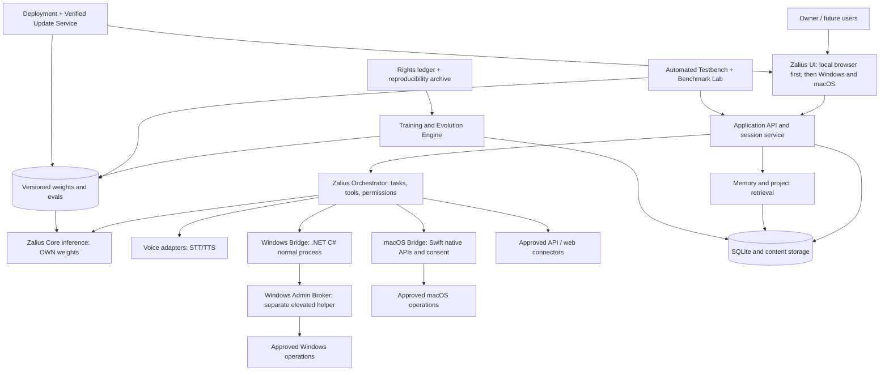

# ZALIUS AI — MASTER ENGINEERING BLUEPRINT

**Version:** 1.3 — final-systems architecture, browser-first qualification, Windows/macOS, and signed distribution (owner approval pending)  
**Prepared:** 7 October 2026  
**Revision:** 1.3 preserves all v1.2 requirements and adds six mature platform systems (deployment, security, updates/recovery, benchmark laboratory, cross-platform compatibility, and data/reproducibility) plus the explicitly agreed browser → test → Windows/macOS apps → per-platform test → official-download-site sequence. No feature is asserted as implemented.  
**Status:** Specification baseline; **not implemented, trained, tested, or approved for release**  
**Intended reader:** Claude Code as implementation engineer, followed by Zalius's own development agent  
**Project principle:** Claude **builds** Zalius. Claude does **not power** Zalius at runtime.

> **Read this entire document before coding.** This blueprint is the single product and engineering intent. A feature listed here is a requirement or a future goal, **not evidence that it exists**. Do not try to finish the whole product in one session. Execute one approved milestone at a time, produce test evidence, and maintain a permanent development record. The owner decides when to advance.

---

## 0. Executive contract and non-negotiables

### 0.1 What Zalius is
Zalius AI is a privately owned, general-purpose conversational AI platform being developed on a Windows computer. Its central intelligence, **Zalius Core**, must be an original decoder-only language model with independently trained weights, not a wrapper that routes questions to Claude, ChatGPT, or another provider's model. Claude Code may author the code, tools, data-processing scripts, training recipes, user interface, and tests. After handover, the owner intends to **stop relying on Claude for ordinary development and operation** and work with the Zalius development agent. Whether that agent is capable of independently handling each kind of task must be established by testing, not assumed.

Primary initial user: the owner, running locally. Later goal: a product customers can install or use commercially **after months of practical evaluation and reliability work**. Usage limits, pricing, and billing are deliberately deferred.

### 0.2 Requirements that cannot be quietly changed
- **OWN-001 — Independent brain:** No Claude/Anthropic/OpenAI or other provider inference in Zalius Core's runtime path. No externally pretrained language-model checkpoints. Third-party **software libraries** are allowed with compliant licenses; pretrained model weights are not allowed in Core. Auxiliary voice models would require explicit labeling and separate approval: they may not be passed off as Zalius Core.
- **OWN-002 — Verifiable separation:** With network disconnected and Claude Code absent, the running application must answer from a locally stored Zalius Core checkpoint. Logs must prove which checkpoint served the request.
- **OWN-003 — Full vision, staged engineering:** Claude sees all requirements up front; only the active approved milestone may be implemented. No feature can be represented as finished without evidence.
- **OWN-004 — Normal and Developer modes:** Both may use the PC; Developer Mode adds advanced code, terminal, configuration, registry, services, troubleshooting, and approved administrative capabilities.
- **OWN-005 — Autonomous, not reckless:** Within explicitly granted scopes, Zalius may execute a series of commands without asking about each trivial step. Destructive actions, credential exposure, and administrator elevation require proportionate Windows authorization and hard boundaries. No bypass of authentication, UAC, paid permissions, or another product's restrictions.
- **OWN-006 — Honest capability:** A model trained from scratch on an RTX 3050 4 GB is a genuine research model, but **not equivalent to current ChatGPT or Claude**. Do not conceal this with unannounced cloud fallbacks or canned answers.
- **OWN-007 — Preserve work:** Versioned model weights, code, datasets, settings, memories, experiments, and rollback records survive updates and crashes.
- **OWN-008 — Expand with hardware:** Training and serving configurations must be discoverable and scalable when a future GPU is installed; upgrade does not by itself improve model intelligence.
- **OWN-009 — Future owner benefits:** Future commercial usage metering does not charge the verified owner account at the product layer, though compute and hosting still cost money.
- **OWN-010 — Commercial release later:** Build and validate the product first. Do not spend early milestones building subscriptions or public storefronts.
- **OWN-011 — Professional coding parity is a TARGET, not a current feature:** Zalius must be engineered toward independently performing the full range of coding jobs handled by leading Claude Code and ChatGPT coding workflows. This means capable model weights **and** a complete local engineering agent. Reach claims require fair externally verifiable head-to-head evaluations; no claim of parity is allowed because the application has a terminal or because Claude wrote the code.
- **OWN-012 — No borrowed coding intelligence:** During Zalius operation, its coding agent must plan and generate changes using Zalius Core (or future first-party Zalius models), not silently call Claude, ChatGPT, Codex, third-party code LLMs, or remote “fallback” models. Development assistance from Claude Code is permitted **only while building Zalius**.
- **OWN-013 — Honest Claude replacement gate:** The owner may stop using Claude Code when desired, but Zalius is not certified as its replacement for a task category until independent blind tasks demonstrate comparable quality, safety, and reliability under equivalent tool access and resource constraints.
- **OWN-014 — Automated marathon testbench:** Claude Code must engineer repeatable, mostly unattended testing that exercises every implemented subsystem for hours, days, and repeated runs; records failures and reproductions; fixes root causes; and reruns regressions. The owner must not be required to manually click through browser screens as the primary QA method.
- **OWN-015 — Train and test concurrently when viable:** The build and training system may train **candidate** Zalius weights while independent software tests run, provided a resource scheduler prevents GPU/VRAM contention, eval-data leakage, checkpoint corruption, and unsafe administrative actions. On the initial 4 GB VRAM GPU, heavy GPU tests and GPU training usually require **time slicing**, not full simultaneous GPU usage.
- **OWN-016 — Browser-first and independent desktop gates:** The functioning browser experience and its AI/backend must pass a declared qualification gate BEFORE developing distributable desktop releases. Then Windows and macOS implementations are separately built and qualified on real supported host systems. Passing browser or Windows tests is not evidence that macOS passes. Long soak tests reduce but cannot eliminate unknown defects.

- **OWN-017 — Release sequence is a dependency:** Research/train Core → functional local browser application → automated browser/backend/model qualification → Windows and macOS packages + native integrations → isolated qualification of each installed app → approved official Zalius site with verified downloads. A public website is not a substitute for a trained, functioning model.
- **OWN-018 — Deployment transparency:** Private local/offline execution is the owner's baseline. Future customers may choose supported local inference or an explicitly identified owner-operated hosted deployment. No hidden external AI model or unconsented data routing.
- **OWN-019 — Update/recovery integrity:** Signed/authenticated updates with compatibility checks, data preservation, transactional rollout and rehearsed recovery are prerequisites for public distribution.
- **OWN-020 — Reproducible intellectual property:** Persist dataset rights, software licenses, experiment provenance, build recipes and artifacts so the platform can be independently maintained, rebuilt and audited without Claude Code.
- **OWN-021 — No unqualified parity/perfection claims:** Model, coding, cross-platform and security claims are tied to published test protocols, versions and evidence; no claim of absolutely bug-free software.

### 0.3 Explicit non-goals and forbidden shortcuts
No claim of access to OpenAI's private model weights, internal systems, proprietary data, or exact reproduction of how current ChatGPT is engineered. No promise of 100% bug-free software, guaranteed AGI, universal API access, or autonomous self-rewriting without validation. No "AI" labels on hardcoded canned-response demonstrations. No covert bypasses of OS protections. No immediate paid SaaS launch. No reproducing OpenAI branding or copying the distinctive ChatGPT interface pixel-for-pixel.

### 0.4 Definition of blueprint completeness
**100% specification coverage** means every *currently agreed requirement* has an owner-visible ID, implementation strategy, dependencies, acceptance criteria, and phase. It does **not** mean all development outcomes are guaranteed. New discoveries will require controlled change requests. The owner must approve this baseline before Claude starts milestone 1.

---

## 1. Scientific foundation: how to emulate the publicly known GPT development *process*

### 1.1 Verified historical progression — distinguish the eras
1. **Transformer foundation (2017):** Attention-based architecture enabling parallel training on token sequences, described by *Attention Is All You Need*.
2. **Original GPT (2018):** Decoder-style Transformer language-model pretraining on text, followed by task-specific fine-tuning; learn general representations from text before specializing.
3. **GPT-2 (2019):** Scaled autoregressive language-model pretraining and generation; a model can produce open-ended continuations without handcrafted task-specific pipelines.
4. **InstructGPT/ChatGPT method (2022):** Start from a pretrained language model, apply supervised training on example instructions/conversations and preference-learning methods. OpenAI's 30 November 2022 ChatGPT write-up describes supervised dialogue examples, human rankings, reward modeling, and PPO-based RLHF for its initial public ChatGPT.
5. **Modern application layer:** Chat, memory, files, projects, voice, external tools, permissions, connected sources, and task orchestration are application and system-design concerns **in addition to** the language model.

**Implementation decision:** Use publicly documented research *principles*, with modern **Python + PyTorch** instead of assuming that historic libraries or undocumented OpenAI internals are required. The historical record is not a secret recipe for reproducing commercial-scale intelligence.

### 1.2 Required reading for Claude (cite findings in research notes)
- Original GPT paper: https://cdn.openai.com/research-covers/language-unsupervised/language_understanding_paper.pdf
- Original ChatGPT methods: https://openai.com/index/chatgpt/
- GPT-2 public release: https://openai.com/index/gpt-2-1-5b-release/
- Transformers: https://arxiv.org/abs/1706.03762
- InstructGPT: https://arxiv.org/abs/2203.02155
- Current PyTorch Windows installation: https://pytorch.org/get-started/locally/
- Microsoft UI Automation: https://learn.microsoft.com/en-us/windows/win32/winauto/uiauto-uiautomationoverview
- Microsoft administrator privilege guidance: https://learn.microsoft.com/en-us/windows/win32/secbp/running-with-administrator-privileges

**Research gate R-01:** Produce a traceable, factual research memo: claims, source links, release dates, elements Zalius will implement, deviations, and unknowns. Do not equate architectural resemblance to equal performance.

---

## 2. Product inventory and phase tags

Legend: **P0** = first functioning brain / engineering infrastructure, **P1** = local usable assistant, **P2** = advanced agent capabilities, **P3** = commercial-only. An item can be specified now but implemented later.

| ID | System | Exact deliverables | Phase |
|---|---|---|---|
| QA | Autonomous Testbench and Release Qualification | Automated unit/integration/browser/desktop/model testing; marathon soak; fault injection; train/test scheduling; reproducible reports; desktop packaging qualification | P0 infrastructure; P1/P2 coverage; P2 pre-release gate |
| CORE | Independent model | Tokenizer, decoder-only Transformer, training, checkpoints, inference, generation configuration, evaluations | P0 |
| DATA | Data pipeline | Source manifest, licensing, ingestion, normalization, dedupe, splits, safety/PII filtering | P0 |
| APP | Conversations | New chat, history, titles, search, edit, regenerate, branching if chosen, archive, delete, export, temporary chat, streaming, stop | P1 |
| STORE | Persistent records | Chats, attachments, models, settings, action history, projects, backup/restore, schema migration | P1 |
| MEM | Memory | Chat context, retrieval, user-approved long-term preferences, project scope, inspect/correct/delete/disable/export | P1 |
| PROJ | Projects | Dedicated chats, files, instructions, scoped memories, search, export | P1 |
| VOICE | Speech | Microphone, STT, TTS, voice/style choice, interruption, text/voice handoff, visible mic status | P1/P2 |
| PC-N | Normal PC control | Launch/switch apps, basic file tasks, browser UI, typing, volume, basic settings | P1 |
| PC-D | Developer PC control | Terminal, code/files, Git, builds/tests, registry, services, scheduled tasks, startup, approved networking/diagnostics | P2 |
| ADMIN | Elevation broker | Least-privilege privileged helper, signed operations, UAC, logs, explicit scoped authorization | P2 |
| API | API intelligence | Documentation inventory, availability/price/auth classification, local probing, version tracking, legal alternatives | P2 |
| AGENT | Planning/execution | Task planner, tool router, executor, verifier, retries, resumable jobs, logs and abort | P2 |
| CODE | Professional software engineering intelligence | Code understanding, code-heavy data/training, repository navigation, refactoring, debugging, testing, build/deploy, automated issue solving, fair parity evaluations | P0 research; P1 foundation; P2/P2+ maturity |
| PERF | Performance | CPU/GPU/RAM/thermals monitoring, game/stream-aware scheduling, avoid interfering with active games | P2 |
| EVO | Evolution | Hardware detection, datasets/experiments, model comparisons, candidate promotion and rollback | P2 |
| SET | Settings | General, appearance, personalization, memory, voice, projects, privacy, permissions, hardware, training, security, logs | P1/P2 |
| WEB | Research | Authorized browsing, citations, source provenance, offline-mode indicator | P2 |
| EXT | Plugins/connected apps | Capability registry, explicit auth, per-app scopes, revocation, audit | P2 |
| TASK | Scheduled work | Owner-authorized local scheduler, status, notification, expiration and cancellation | P2 |
| DEP | Local/hosted model deployment | Device capability profiling; local/offline inference, optional consent-based Zalius-hosted inference, model packaging | P1 design; P2 support; P3 hosting option |
| SEC | Platform security | Identity/session protection, encryption, secrets, privileged separation, supply-chain controls and signed releases | P0 design; P1/P2 implementations; P3 audit |
| UPD | Verified updates and recovery | Model/app update manifests, signature verification, compatibility, staging, rollback, disaster recovery | P1 backups; P2 app release; P3 public channels |
| BENCH | Benchmark laboratory | Versioned reasoning/language/coding/tool/voice benchmarks, sealed test data, comparable reports and promotion criteria | P0 foundation; P1/P2 ongoing |
| XP | Cross-platform capability | Shared browser product; native Windows bridge and separate macOS-specific bridge/permissions/testing | P1 browser; P2 desktop builds |
| REPRO | Data ownership and reproducibility | Dataset/license lineage, data removal, reproducible experiments, SBOM, checkpoint/model cards, independent rebuilds | P0 foundation; continuing |
| DIST | Official downloads and release website | Website, installer manifests, OS requirements, checksums/signatures, release notes, secure downloads | P3 only after desktop approval |
| BIZ | Commercial systems | Customer auth, entitlement ledger, token/credit usage, abuse controls, updates, support, licensing | P3 |

**Feature rule:** For each inventory entry, create an individual `specs/<ID>.md` record with (a) user stories, (b) contracts/API schemas, (c) data persistence, (d) permissions, (e) expected latency, (f) happy-path test, (g) failure/rollback test, (h) dependencies, (i) owner sign-off. A UI control without an implemented action is disabled and labeled, not deceptively enabled.

---

## 3. Reference architecture and inter-component boundaries



### 3.1 Recommended technology choices (subject to environment verification)
- **Model/training:** Python 3.12+, PyTorch, tokenizer implementation with auditable vocabulary training. Use familiar tooling but never load third-party language-model weights into Core.
- **Local backend:** Python service (e.g. FastAPI) with typed request/response contracts, streaming generation, health endpoints and background job queue.
- **Frontend:** TypeScript + accessible React browser UI hosted locally first; qualify the browser application before Windows/macOS wrappers. Keep shared design-system and API contracts; choose desktop packaging technology by ADR after confirming native-bridge, signing, accessibility, and installer requirements.
- **Windows Bridge / privileged helper:** C#/.NET with typed IPC, authenticated local channel, least-privilege process split. Windows APIs and PowerShell are implementations, not magical escalations.
- **macOS integration (future):** Swift/native APIs (subject to Apple permission and entitlement review), a separate scoped helper if needed, platform-specific test fixtures; never assume Windows Win32/.NET system calls will work on macOS. Apple silicon acceleration/Metal must be evaluated separately from NVIDIA CUDA.
- **Storage:** SQLite with FTS and migrations for chats/projects/metadata; filesystem blobs for datasets/checkpoints/attachments; future vector index only when warranted by evaluations.
- **Jobs:** Persisted job states; queue, timeouts, cancellation, resume and concurrency budgets. Avoid introducing distributed infrastructure before needed.
- **Configuration:** Versioned file + typed validation, user settings in DB, secrets in Windows Credential Manager/DPAPI or equivalent secure store, never plaintext in logs.
- **Observability:** Structured events with correlation IDs and local privacy controls; minimal redaction-safe telemetry.

### 3.2 Architectural laws
- A **model checkpoint is replaceable** without deleting conversations or memory.
- Memory retrieval is **not the same as training a model's weights**.
- Tool execution is separated from natural-language generation by typed contracts and permissions.
- Untrusted web pages, documents and tool outputs are **data**, not instructions with authority to run arbitrary PC commands.
- Every operation has a result object: requested action, selected method, scope, status, evidence, duration, and reversible actions if any.
- Independent agents may plan/execute, but cannot quietly grant themselves extra privileges or erase their own audit history.
- The application remains usable for viewing history/settings even if model loading fails.

### 3.3 Proposed repository layout
```text
zalius/
  README.md                       # honest current status + local setup
  CLAUDE.md                       # builder operating rules
  docs/architecture/              # ADRs, sequence diagrams, trust boundaries
  docs/research/                   # historical sources and research decisions
  docs/specs/                      # per-feature contracts and acceptance tests
  docs/journal/                    # milestone notes and reproducible results
  model/core/                      # tokenizer, config, Transformer, generation
  model/data/                      # data ingest, manifests, normalization/splits
  model/train/                     # training, checkpoint/restart, metrics
  model/eval/                      # held-out and behavior benchmarks
  model/eval/coding/               # coding suites, isolated tasks, comparator runs
  services/api/                    # web API and session handling
  services/orchestrator/           # plans, queues, permissions, verification
  services/coding-agent/           # repository tools, edit engine, build/test feedback
  services/memory/                 # durable memory and project retrieval
  services/evolution/              # experiments + promotion gates
  services/deployment/             # local/hosted routing policies and capability checks
  services/updater/                # signed manifests, stage/apply/rollback
  windows/bridge/                  # C# native Windows API interactions
  windows/admin-broker/            # scoped privileged actions
  macos/bridge/                    # native Swift/Apple APIs and permissions (future)
  platforms/contracts/             # platform-neutral action interface and tests
  ui/                              # web client
  tests/unit/ tests/integration/ tests/e2e/
  tests/model/ tests/soak/ tests/chaos/ tests/security/
  tests/browser/ tests/windows/ tests/macos/ tests/voice/
  tests/installer/ tests/upgrade/ tests/repro/
  testbench/                        # profiles, scheduler, runner, fixtures, reports
  benchmarks/                       # sealed datasets, harness, scorecard, comparators
  release/                          # cross-platform installers, signing, manifests, site
  rights/                           # dataset/weights/license ledger, SBOMs, provenance
  scripts/                         # reproducible local dev tasks
  artifacts/                       # ignored outputs; explicit manifest/index
```

---

## 4. Zalius Core — implement an independent brain

### 4.1 Autoregressive model contract
Create a configurable **decoder-only causal Transformer** with token embeddings; learned or rotary position handling selected via ADR; repeated pre-normalized self-attention + MLP blocks; causal attention masking; final normalization; output logits tied to embeddings where appropriate. Model input is token IDs and optional masks, output is next-token logits and loss for labeled training. Generation supports greedy, temperature and top-k/top-p sampling with explicit seeds, context limits, max-output tokens and stop sequences. Version configs with each checkpoint.

**Model authenticity:** Randomly initialize all Zalius Core weights; no download of commercial/open pretrained LLM checkpoints; train from legally usable text. Reimplementing standard architectures is fine; claim originality only for code/weights you actually developed, not for inventing Transformers.

### 4.2 Proposed hardware-aware model sizes (planning ranges, not promises)
| Experiment | Illustrative target | Goal |
|---|---|---|
| E0 | 1–5 million parameters | Validate math, forward/backward pass, loss reduction on tiny corpus |
| E1 | ~15–40 million parameters, 256–512-token context | Demonstrate genuine local pretraining on 4 GB VRAM if benchmark confirms fit |
| E2 | Larger only after profiling or new hardware | Increase model/data/context systematically if cost and evaluation support it |

**No fixed numbers until measured:** Claude must inspect available VRAM, compute capability, CUDA version, free disk, throughput, max safe batch/sequence length, gradient accumulation, checkpointing options and CPU fallback. Mixed precision can help if supported and stable. GPU usage must coexist with gaming/streaming via explicit resource governor; training pauses instead of silently degrading gameplay.

### 4.3 Core tokenizer
Implement/train tokenizer on approved corpus using BPE or unigram algorithm; reserve special tokens for beginning/end, padding (if needed), user/assistant/system roles and tool markers. Persist vocabulary, merges, normalization behavior, hashes, version and compatibility tests. Test Unicode, multilingual text, punctuation, code and round-trip decode; explicitly document information-loss behavior.

### 4.4 Training pipeline
1. Load source manifests and licensing/provenance data.
2. Normalize, deduplicate, clean, filter PII/secrets, and separate train/validation/test **before** near-duplicate leakage occurs.
3. Train tokenizer on allowed training data only; version it.
4. Shard/tokenize training records with integrity hashes and deterministic seeds.
5. Train causal language-model objective with optimizer (e.g. AdamW), documented learning-rate schedule, grad clipping, checkpoint/restart and validation tracking.
6. Plot train/validation loss, tokens/sec, peak memory, wall time, estimated electricity/compute budget; keep sample generations clearly labeled as samples, not benchmark proof.
7. When a real base model exists, perform supervised instruction/chat fine-tuning with legally usable, curated example dialogues, plus code-focused instruction/task data when the coding objective is enabled. Include tests, reviews, patch explanations, and debugging trajectories as appropriate; do not train against reserved evaluation answers.
8. Later, if data quality and compute justify it, explore preference optimization; original ChatGPT used reward modeling and PPO-based RLHF, but **RLHF is not a mandatory first-milestone dependency**.
9. Publish model card for each promoted internal checkpoint: origin, limits, training data categories, evals and known failure modes.

### 4.5 Data rules and legality
Allowed sources require a clear permitted-use basis, documented attribution/licensing as relevant, commercial-rights review for future sale, and terms-of-service compliance. Collect quality conversational/instruction data, general prose, reasoning examples, translations, programming examples, and safe task examples. Dictionaries alone will not create fluent assistants. Do not scrape restricted sites or ingest credentials, private chats or copyrighted corpora without rights. Keep a revocation/removal process and traceability from checkpoint to dataset revisions. Respect real-world privacy obligations before public release.

### 4.6 Evaluations / exit gates
- **Math test:** Shapes, causal mask, gradient flow, stable loss, no NaNs, deterministic small-seed repeatability.
- **Learning test:** Demonstrate loss reduction on held-out data compared with an untrained random baseline and a simple n-gram baseline where useful; distinguish overfitting from generalization.
- **Generation test:** Load checkpoint after fresh process restart; produce non-canned variable text locally; report speed and memory.
- **Knowledge/reasoning:** Fixed prompt suite: simple facts, logical consistency, math, explanations, code syntax, refusal of unsupported claims. Record measured failure rate; initial model may score poorly.
- **Conversation:** Multi-turn context test, follow-up corrections, role formatting and prompt injection robustness.
- **Independence:** Disconnect network, disable Claude, inspect outgoing requests; verify Core returns answers solely from the saved locally trained checkpoint.
- **Regression:** Never promote a new checkpoint if benchmark aggregate and critical safety/quality tests are worse than pre-agreed tolerances.

**Do not write:** “ChatGPT-level.” **Write:** “Zalius E1 baseline achieved X loss, Y eval score, Z tok/s on recorded hardware.”

---

## 5. Zalius application and exact behavior

### 5.1 Conversation UI — APP-001 to APP-014
- APP-001 New conversation creates durable ID, timestamp and message list.
- APP-002 Sidebar displays history with pagination and keyboard navigation.
- APP-003 Automatic titles may be generated by Zalius Core; fallback is truncated first user prompt, clearly deterministic.
- APP-004 Manual rename updates persistence and search.
- APP-005 Search indexed titles/content with result navigation.
- APP-006 Archive/unarchive hides from default view without deleting.
- APP-007 Delete requests confirmation or uses undo/trash retention; deletion removes history according to data policy.
- APP-008 Export one/all chats as interoperable JSON/Markdown.
- APP-009 Temporary chat persists only for current temporary lifecycle and never feeds long-term memory by default.
- APP-010 Edit message creates a branch or explicitly invalidates dependent later turns; never silently rewrites history.
- APP-011 Regenerate output records model, generation parameters, original message relationship.
- APP-012 Stream text and support stop/cancel in flight without corrupting history.
- APP-013 Attach permitted documents/images with file size/type restrictions; support depends on working parser/vision capability, never imply Core has image understanding before it exists.
- APP-014 Display errors with actionable retry; distinguish model, tool and storage failure.

**UI test examples:** every action survives app restart; export round-trips; temporary chat not cross-retrieved; chat search returns expected IDs; cancel stops generation within a measured target.

### 5.2 Projects — PROJ-001 to PROJ-007
Create/rename/archive/delete project; project-level instructions; project chat membership; uploaded source inventory; scoped search/memory; export; prevent accidental context leakage between project-only spaces. Show when response used project material. Shared project permissions deferred to commercial phase.

### 5.3 Memory — MEM-001 to MEM-010
Current conversation context, explicit preferences, candidate cross-chat recall, project-only memory, facts with source/time/confidence, contradiction resolution, user edits, erase and export, memory disabled mode, retrieval test suite. Memory updates may be proposed by a background consolidator, but must be auditable and must not silently insert secret data into training corpus. Expired/contradictory entries are marked or corrected, not treated as immutable truth. Retrieval must respect privacy scopes.

### 5.4 Voice — VOICE-001 to VOICE-009
Push-to-talk; optional wake behavior only after explicit opt-in; STT; TTS; selectable voice/speaking speed; interruption/barge-in; visual mic/transcription state; voice/text continuity; mic/device errors and permissions; voice data retention control. **Core independence applies to conversation reasoning, not automatically to speech codecs**. If voice requires separately sourced speech weights, identify their provenance and commercial permissions, keep offline/local goal where practical, and never falsely describe those weights as self-trained Zalius Core.

### 5.5 Settings inventory — SET-001 to SET-020
General: start-on-boot, default launch, notifications, language, update channel, keyboard shortcuts. Appearance: light/dark, density, accent, font scale, reduced motion. Personalization: response style, custom instructions, memory toggles. Privacy: data export/deletion, telemetry opt-in, temp chat, retention. Voice: mic, voice, speech pace, interruption. Projects: default scope. Hardware: CPU/GPU/RAM budget, training pause during gaming, power preference. Intelligence: loaded checkpoint, context length, generation params, measured capabilities. Windows: per-app and per-operation permissions; Developer Mode switch; autonomous time/scope grants, audit log and emergency stop. API: catalog, keys/connection status, scopes, disconnect. Evolution: experiments, metrics, candidate/rollback. Accessibility: keyboard, screen-reader semantics, captions and focus. Security: owner authentication, recovery/backup, credential storage. **Each setting must persist, actually change behavior, have a default, valid bounds and a test.**

---

## 6. Windows Bridge — high-speed, authorized PC control

### 6.1 Three execution paths and routing
1. **Direct native or documented app API**: file/system APIs, PowerShell cmdlets, Win32/.NET, authenticated app integrations, when available and permitted.
2. **Windows UI Automation**: controls, control patterns, events, keyboard focus, selections, if app exposes accessibility tree.
3. **Screen-based fallback**: approved window capture + input simulation when no reliable direct method exists. Visible screen content may contain private data; permission/retention rules apply.

Router evaluates cost, latency, reliability, reversibility and permissions; chooses fastest *reliable authorized* method. Prefer event-driven wait + verification over blind sleeps; parallelize **independent** tasks only. Timeouts prevent loops. Never claim all apps are automatable; protected desktops and app-specific UIs can block access.

### 6.2 Normal Mode — PC-N
Open/close/switch apps; approved folder search and organization; basic file creation/rename; read-only system overview; type/paste in focused applications; browser tabs and navigation; volume and display basics through supported controls. File deletion or sharing uses explicit scope and confirmation rules. It must not inherit Developer privileges automatically.

### 6.3 Developer Mode — PC-D
Everything in Normal plus allowed terminal/process execution, code authoring, builds/tests, Git, dependency installs, environment variables, registry **read/export/create/edit/delete**, system services start/stop/query, Task Scheduler, startup configuration, event logs, hardware/driver diagnostics, network/firewall tools, disk/backup tools and approved repair commands. All affected entities/keys/commands must be typed and logged. Read-only inspection can be less restrictive than writes.

### 6.4 Zalius Admin Broker — ADMIN
Main app remains non-elevated. Separate .NET helper obtains elevation via supported UAC path only for operations requiring it. Operation schema: `action_id`, `target`, `parameters`, `requested_privilege`, `authorization_id`, `expected_effect`, `recovery_plan`. A short-lived authorization may preapprove a **limited class** of tasks, but must never mean unrestricted machine-wide elevation forever. Restrict helper's callable operations to validated command handlers; no unauthenticated arbitrary shell. Sign/verify requests or authenticate secure local IPC, protect against command injection and confused-deputy attacks; audit. UAC and credential requirements are never bypassed.

### 6.5 Autonomous Developer Mode — AGENT/ADMIN
Owner activates for a defined task and scope: approved workspace roots, commands/tools, network domains if any, max run time, spending limit, safe action categories. Zalius then handles many routine steps without repetitive prompts. Stop for changes outside scope or irreversible/high-impact operations; emergency stop terminates queued actions and revokes scoped grants. Show a live task trace and post-action summary. Do not store blanket admin tokens or defeat Windows access controls.

### 6.6 The “No Dead Ends” protocol
If API method fails: classify failure; inspect docs and local environment; try alternative **permitted** interfaces; write a custom integration against supported public interfaces if practical; test in sandbox; report best available alternative. **No Dead Ends** means persistent problem-solving within authorization—not circumventing account access, security policy, subscriptions, or other systems' protections.

### 6.7 Test scenarios and quality gates
- **W-01 Notepad:** Find window, type exact supplied text, save in a temporary approved folder, reopen, compare file bytes and log API path used.
- **W-02 File organization:** Move/copy/rename fixture files; reject out-of-scope path; verify rollback and final directory state.
- **W-03 Registry:** In disposable test key under `HKCU\Software\ZaliusTest`, export original state, write value, read back, restore; never start with production keys.
- **W-04 Services:** Query a safe fixture/service; demonstrate elevated action denial without authorization and success only with appropriate privileges.
- **W-05 Resilience:** Simulate window closed, delayed load, UI target changed, permission denied, network unavailable; no false success.
- **W-06 Latency:** Report p50/p95 time for repeated supported tasks and compare direct API vs UI Automation vs visual fallback.
- **W-07 Emergency stop:** Interrupt queued tasks; demonstrate no unapproved subsequent execution.

---

## 7. API Discovery and Intelligence Center

**API-001** Curated registry of APIs: name, purpose, official docs, OS/version, package version, permissions, auth type, rate limits, price, license, supported methods and latest verified timestamp.  
**API-002** Search the registry for capabilities (“change volume,” “read GPU temperature,” “manage scheduled task”).  
**API-003** Local **read-only** probes verify installed SDKs, accessible APIs, required privileges, and compatibility.  
**API-004** Typed method adapters enforce input schema and output verification; adapters must not execute raw untrusted tool text.  
**API-005** Alternative path search (Win32, .NET, PowerShell, app API, UIA) with permissions matrix.  
**API-006** Version tracking, stale docs flags, known failures and end-of-support checks.  
**API-007** Clear UI labels: available; needs owner authorization; needs credentials; paid service; unsupported; not yet tested.  
**API-008** Never interpret "research every API" as literally cataloging all APIs worldwide before shipping. Prioritize APIs with evidence of user value; expand continuously.

**Test:** mock an API absent on a particular machine; registry returns appropriate classification; router finds authorized fallback; no auth bypass; API record contains supporting source.

---

## 8. Reasoning, agents, tasks and trusted tools

The model alone does not inherently have robust planning, coding or computer-operation skills. Build a **tool orchestration layer** that receives natural-language requests, converts them into bounded plans, validates requested steps against user scope, executes tools, checks outcomes and asks only when necessary.

**AGENT-001:** Task decomposition with dependency graph and measurable end condition.  
**AGENT-002:** Planner / executor / verifier separation; verification based on external state rather than the model saying “done.”  
**AGENT-003:** Typed tool manifests, schemas and policies.  
**AGENT-004:** Multi-step persisted jobs with pause/resume/retry/timeouts, idempotency keys and budgets.  
**AGENT-005:** Audit log with action inputs redacted as needed, outputs, duration, errors and recovery.  
**AGENT-006:** Tool-safe handling of prompt injection and untrusted documents.  
**AGENT-007:** Local repository coding agent may read, edit, run tests, and prepare diffs inside granted workspace.  
**AGENT-008:** Separate promotion gates for source code edits and model weight changes.  
**AGENT-009:** Scheduled tasks opt-in, transparent owner management, cancellation, notifications.  
**AGENT-010:** Progress UI shows current step, blocked reason, actual execution proof.
**AGENT-011:** Complex coding tasks use the dedicated Zalius Coding Intelligence workflow defined in Section 8A, with tool outputs and benchmark reports kept separate from model training examples.

**Capability honesty:** Until Zalius Core achieves sufficient reasoning skill, a sophisticated shell may still produce limited autonomy. Test with reproducible scenarios before promising independent development after Claude is removed.

---


## 8A. Zalius Coding Intelligence — professional coding target (CODE-001 to CODE-020)

### 8A.1 Precise user requirement and honest feasibility
The owner requires Zalius to **eventually match or outperform leading Claude Code and ChatGPT coding experiences** across meaningful real-world tasks, while generating solutions with **Zalius-owned intelligence**, not licensed third-party coding-model weights or API calls. Treat this as a **north-star competitive acceptance objective**, not as an assertion about what can be guaranteed or trained on an RTX 3050 4 GB. Parity may demand vastly more computing resources, high-quality legally usable data, expert evaluation, research advances, and repeated iterations. No predetermined completion date or guarantee of reaching parity is scientifically defensible.

**Two distinct abilities must be measured:** (A) **model coding capability**: Zalius Core understands programming and proposes correct source code; (B) **agentic software engineering capability**: the application operates over real repositories with tools, plan/execute/verify loops, and produces verified changes. A sophisticated agent cannot compensate fully for an incapable base model. A powerful base model cannot complete end-to-end projects without robust tools and state management.

### 8A.2 Functional inventory and implementation contracts
- **CODE-001 — Task understanding:** Parse user requirements and repository conventions; discover missing inputs; create a scoped plan and verifiable definition of done.
- **CODE-002 — Repository comprehension:** Read the tree, symbols, dependencies, manifests, configuration, docs, and version history; maintain a searchable symbol/repository map with context window budgeting. Never assume the entire repo fits in context.
- **CODE-003 — Multi-language work:** Progressive verified support for Python, C#, .NET, TypeScript, JavaScript, HTML/CSS, SQL and PowerShell relevant to Zalius; expand later to C/C++, Rust, Go, Java, and other languages based on real tests. No blanket “supports all languages” claim.
- **CODE-004 — Generate real software:** Implement modules, APIs, UI, database schemas, build files and configurations with dependency compatibility and license checks; generate clean, maintainable code rather than superficial scaffolds.
- **CODE-005 — Multi-file editing:** Propose structured diffs, insert/delete/rename files transactionally where possible; account for imports, interfaces, tests, migrations, documentation and backward compatibility.
- **CODE-006 — Debug:** Reproduce errors from logs, failing tests, stack traces, compiler output, runtime and integration behavior; state hypotheses and change only the affected scope.
- **CODE-007 — Repair and refactor:** Fix root causes, preserve public contracts unless approved, migrate code safely, keep regression tests, and compare behavior before/after.
- **CODE-008 — Testing:** Write useful unit/integration/e2e tests, run them, interpret failures, handle flaky tests, verify the absence of regressions; distinguish tests written by the agent from independent external tests.
- **CODE-009 — Tool use:** Use authorized terminal, compiler, package manager, debugger, formatter/linter, test runner, Git and CI; use native Windows APIs where useful; track commands, exit codes, artifacts and elapsed time.
- **CODE-010 — Git work:** Inspect diffs, create branches, preserve the owner's changes, commit requested work, prepare review summaries, and revert the agent's changes when needed. Never force-push or delete history without specific authorization.
- **CODE-011 — Build and deploy:** Compile and package target programs and, when approved, deploy to permitted local/test destinations; verify launch/runtime health after build. No production deployment by default.
- **CODE-012 — Long-horizon jobs:** Persist plans, decisions, repository revision, environment, artifacts, test outcomes and resumption state; recover after restart without blindly rerunning destructive commands.
- **CODE-013 — Context and knowledge:** Retrieve relevant local docs/API references with source versions; apply project instructions; treat external code, README text and web pages as untrusted data, not executable higher-priority instructions.
- **CODE-014 — Fast reliable operation:** Prefer direct filesystem/compiler/API operations over screen automation, reuse environments where appropriate, cache safe intermediate outputs, parallelize only independent work; benchmark speed without sacrificing correctness.
- **CODE-015 — Code quality:** Enforce agreed formatting, typing, dependency hygiene, supply-chain checks, security scanning, accessible UI patterns and project-specific conventions.
- **CODE-016 — Permissions:** Normal Mode may explain code and perform approved simple file edits; Developer Mode activates scoped terminal, repository, build and admin tools. No privilege escalation or unrestricted execution by default.
- **CODE-017 — Self-improvement of engineering ability:** Train only candidate weights/code in controlled experiments, track learning data provenance, and compare against sealed holdout tasks before promotion. Self-generated fixes are not automatically trustworthy training labels.
- **CODE-018 — Clear communication:** Report work plans, file changes, test command/results, unsolved issues and verified completion, with no fabricated file modifications, commands or successes.
- **CODE-019 — Offline independence:** Under no-network conditions, a Zalius checkpoint must conduct coding reasoning and tool orchestration where dependencies are installed, with no Claude/ChatGPT/Codex model API; log the loaded checkpoint ID.
- **CODE-020 — Comparative competence gate:** Only claim equivalence to a named reference workflow when measured under a versioned, fair, repeatable comparison protocol as defined below.

### 8A.3 Model learning roadmap for programming
1. At M0, identify coding-task families, relevant languages, realistic compute/data budgets and legal code-corpus sources. Design tokenizer tests for identifiers, indentation, brackets, Unicode and long files.
2. From M2 onward, clean/deduplicate license-checked code and code-adjacent text (API documentation, tutorials, tests, bugfix examples) without leaking held-out evaluation answers; retain provenance and license obligations. Do **not** use private repositories or the user's secrets as training data automatically.
3. During base pretraining, measure basic code-token modeling and next-token prediction; maintain both natural-language and code evaluations so improving one does not silently degrade the other.
4. During instruction-tuning, include spec-to-code, bug-to-patch, code explanation, multi-turn coding requests, test-driven development, and tool-result interpretation, with quality-controlled examples and held-out families.
5. Later explore preference training, code execution feedback and verified-repair trajectories; maintain quarantined sandboxes, independent tests, and a strict training/evaluation separation.
6. After a GPU upgrade, recalculate compute/optimizer/context/data targets from real measurements. **A larger GPU alone does not grant Claude-level coding ability**; parity may remain unattainable on personal resources.

### 8A.4 Local coding agent execution pipeline
`Owner goal → workspace permission → repository discovery → context retrieval → plan → Zalius Core generation → scoped code edits → build/test/static checks → error diagnosis/retry → independent verification → Git diff + owner report`.

Each stage has a typed API and failure contract. Record baseline repository revision and a change journal so operations are resumable and revertible; prohibit leaking secrets to prompts or logs. Do not hallucinate tool calls. All verification is done against actual filesystem/build/test state, never solely on the model's narrative.

### 8A.5 Fair head-to-head measurement protocol
- **Reference systems:** Record the exact available Claude Code / ChatGPT coding model and client versions tested, dates, tool setup, compute allowance, maximum attempts, timeouts and allowed repository access. Do not compare Zalius with an unspecified “Claude brain” or selectively easier tasks.
- **Tasks:** Use held-out professional software-engineering tasks: isolated bug repairs, unseen repository issues, multi-file features, refactors, security-sensitive fixes, code review, debugging, frontend/backend integration and Windows/.NET work. Reserve the owner's own unseen real coding problems as a blind evaluation set.
- **Public suites:** Consider SWE-bench Pro (document version, license and harness; protect held-out split), Terminal-Bench for terminal skills, and LiveCodeBench for standalone programming; adapt Windows fixture tests for Zalius's target environment. SWE-bench Verified may serve as a historical baseline but **must not be the only frontier parity test** because of contamination and flawed tests.
- **Contamination control:** Freeze hidden test solutions/fixtures; hash splits; do not train on benchmark answers, gold patches, evaluation transcripts, or live test feedback that reveals solutions. When using accessible public benchmarks, state their limitations and add newly created unseen tasks.
- **Scoring:** Measure independent resolved-task rate (e.g. pass@1), hidden test correctness, regression failures, safety/authorization violations, attempts, time to completion, compute/memory cost, latency and human review load. Use multiple tasks and repeated runs with uncertainty ranges. Keep task failures and timeouts in denominator.
- **Claim rule:** Publish parity **only for precisely named task categories, reference versions and benchmark protocols**, when blind results are statistically comparable within predeclared margins and Zalius has no unacceptable security/reliability regressions. Competing products keep evolving; parity is not a permanent blanket guarantee.
- **Claude exit:** Owner may choose not to use Claude at any time. However the milestone “Zalius fully replaces Claude for professional coding” is **FAILED / NOT VERIFIED** until this parity gate passes. A small working coding agent is not evidence of general Claude/ChatGPT-class coding ability.

**Reference links for the evaluator to verify at implementation time:** https://labs.scale.com/papers/swe_bench_pro ; https://www.tbench.ai/ ; https://github.com/LiveCodeBench/LiveCodeBench ; https://openai.com/index/why-we-no-longer-evaluate-swe-bench-verified/ .

### 8A.6 Progressive acceptance gates
- **CODE-G0 Research:** Document coding objectives, datasets/licenses, model-vs-agent separation, evaluation protocol and realistic ceilings with current hardware.
- **CODE-G1 Genuine model learning:** Zalius Core generates code syntax better than a random/untrained model on unseen simple code tasks; measured, not a string-template trick.
- **CODE-G2 Local repository tools:** Agent reads project structure and creates an approved isolated multi-file patch, runs a compiler/test suite, verifies result, and produces a source diff, fully offline.
- **CODE-G3 Practical owner tasks:** On a blind fixture suite across approved languages, solves an owner-approved percentage of tasks with no material regressions or permission violations. Thresholds are agreed **before** seeing scores.
- **CODE-G4 Advanced independent development:** Resolves unseen real repository bugs/features over several steps, handles failures and resumes interrupted work; comparative quality report against reference agents is available.
- **CODE-G5 Competitive parity aspiration:** Passes the 8A.5 head-to-head competence gate against selected current Claude Code and ChatGPT coding workflows. **Not guaranteed by specification or hardware upgrades.**

## 9. Evolution Engine and continuous improvement

**EVO-001** Detect hardware on launch and after upgrade (CPU, GPU, VRAM, RAM, storage, CUDA/driver).  
**EVO-002** Maintain immutable experiment manifests: code revision, seed, tokenizer, datasets/hashes, hyperparameters, metrics, checkpoint location, resource cost.  
**EVO-003** Candidate training: additional training or fine-tuning only on authorized curated data; avoid catastrophic forgetting and eval contamination.  
**EVO-004** Code self-improvement runs in a branch/sandbox with automated tests, static checks and diff review.  
**EVO-005** Evaluation gates compare candidate against champion on quality, safety, speed, memory, and existing tool behavior.  
**EVO-006** Promotion requires explicit policy criteria and owner confirmation for consequential changes; deployment is atomic, logged and reversible when technically possible.  
**EVO-007** Back up active weights/settings/migrations, keep last known good, rehearse rollback.  
**EVO-008** A hardware upgrade increases possible experiments; it **does not** automatically make an untrained model smarter. New data/training/evaluation are required.  
**EVO-009** Keep conversations/memory in independent versioned stores across model swaps.  
**EVO-010** Track actual owner feedback and bug reports as reviewable candidates, not silent direct weight changes.

**Test:** candidate checkpoint worse on fixed eval -> rejected; current version remains live. Better candidate -> staged rollout with verification and rollback. No self-modification should silently promote untested changes.

---

## 10. Reliability, privacy, security, and performance

### 10.1 Threat model
Assets: owner files, credentials, desktop control, memories, model weights, datasets, payment accounts (future). Threats: malicious prompts/documents, indirect prompt injection, compromised dependencies, command injection, overly broad admin rights, accidental deletion, model hallucinated commands, data leaks, corrupted checkpoints, unauthorized remote requests, customer metering abuse (future).

Controls: least privilege, typed commands, approvals by scope, local-only default, signed/pinned dependencies where available, secrets in protected store, no sensitive output in logs, rate limits, sandbox tests, integrity hashes, secure backup/restore, emergency stop, owner identity protection and consent-based permissions. Do not try to defeat Windows UAC. Document irreversible operations and mitigate them with staging.

### 10.2 Performance and hardware coexistence
- Windows 11, Ryzen 7, 32 GB RAM, RTX 3050 4 GB are **reported** hardware, not verified inventory.
- Local inference must expose measured tokens/sec, p50/p95 first-token latency, peak RAM/VRAM and cold-start time.
- Training and background analysis throttle/pause on owner command, thermal thresholds, game/stream detection or configured GPU budget.
- Separate service health from GUI so a crashing backend does not corrupt chats.
- Test startup/stop, model-swapping, storage migrations, low disk, GPU unavailable, graceful CPU fallback and network-off mode.

### 10.3 Quality practices
Unit tests, integration/e2e tests, property-based tests for parser/tokenizer boundaries, source formatting and type checking, CI on available hardware, dependency auditing, deterministic benchmark inputs, releases with checksums. Prioritize meaningful tests over superficial coverage percentages; coverage reports are supporting evidence, not the product definition. The integrated testbench defined in Section 10A is the implementation standard for all these tests.

---

## 10A. Zalius Automated Testbench — unattended endurance, defect discovery and training coordination

**Owner requirement:** Claude Code designs and builds a **real, automated verification system**, not a manual checklist or a browser demonstration. It must exercise *every implemented requirement* against expected results, run repeatably for extended periods, report real failures, and gate progress toward installed Windows **and macOS** applications. Research and creation of the testbench begin early, but the testbench evolves with each approved milestone. No amount of testing guarantees “perfect” or bug-free software; release decisions use evidence, defined risk thresholds, and owner approval.

### 10A.1 Architecture and exact components

- **TB-001 — Unified test orchestrator:** A versioned `testbench/` runner with machine-readable configs, CLI, resumable test jobs, cancellation, deterministic test seeds, timeouts, worker process supervision, start/stop timestamps, and an owner-facing status/report dashboard or saved HTML report. The primary runner must run without an operator clicking through pages. Each job declares `repo revision`, checkpoint ID, platform/build ID, test profile, fixture versions, permissions, resource budget, and expected result.
- **TB-002 — Test inventory traceability:** Every implementation requirement ID maps to at least one automated happy-path test and one meaningful failure/denial case where applicable. `REQUIREMENTS_MATRIX.md` records `planned`, `implemented`, `automated`, `passing`, `failing`, `flaky`, `blocked`, or `not applicable`, with links to test IDs and evidence. Coverage of requirements is distinct from percentage-based code coverage.
- **TB-003 — Reproducible isolated fixtures:** Temp databases, scratch repositories, dummy API accounts, fake documents, test browser profiles, known Windows apps, disposable registry keys, fixture audio, locally served webpages, and VM/sandbox snapshots; every test cleans up. Never test destructive admin operations on live production/system data or the owner's ordinary profile. Use a Hyper-V/Windows test VM if verified available; otherwise a suitably isolated non-administrative harness. VM testing does not authorize bypassing UAC.
- **TB-004 — Software toolchain:** Prefer `pytest` for Python/model/service tests, `xUnit` or equivalent for .NET Bridge components, Playwright for browser UI automation, and supported Windows UI Automation/native APIs with a purpose-built C# harness for real desktop tests. Evaluate tool versions, licenses and Windows support during M0/M1. Avoid unmaintained drivers and assuming browser automation can validate a native application.
- **TB-005 — Reporting artifacts:** Persist JSON/JUnit reports, redacted logs, screenshots/video of UI failures where permitted, stack traces, profiler summaries, crash dumps only where safe, GPU/RAM/CPU metrics, seed/config, test environment IDs and reproduction commands. All results must say PASS/FAIL/SKIP/FLAKY/BLOCKED; silent missing tests do not count as success. Protect private chats, secrets and user files from report capture.

### 10A.2 Full-surface automated test suites — build as components appear

- **TB-006 — Model math and data:** Tokenizer round-trip/Unicode/property/fuzz tests; attention masks and causal leakage checks; finite loss and gradients; gradient accumulation equivalence within tolerance; dataset deduplication, license ledger, split isolation, seed and reproducibility checks; corrupted/missing shards; input-length boundaries; checkpoint integrity and clean restart.
- **TB-007 — Training pipeline:** Repeatable short train/resume/restart; detect NaNs, divergent loss, bad batches, runaway VRAM/RAM and dataset contamination; simulate interruption mid-checkpoint and restart from last known-good version; compare validation against frozen baselines. Training continues only while explicitly enabled, and candidate weights never silently replace the serving model.
- **TB-008 — Independent intelligence and coding:** Disable network and provider credentials to verify inference uses only the logged Zalius checkpoint; repeat multi-turn dialogue, refusal to invent tool outcomes, reasoning tasks, held-out coding tasks, multi-file repository edits, test-run feedback, controlled Git and rollback, security rules. Treat weak capability as a measured FAIL against the applicable goal, never a shell/UI success. Keep benchmark gold answers separate from any training corpus.
- **TB-009 — Web UI and chat:** Playwright tests for login/session when implemented, navigation/sidebar, new/rename/archive/delete/restore/search chats, editing/regeneration, streamed text, cancel, error and retry, upload/export, temporary chats, responsive layout, themes/fonts, keyboard focus, screen-reader labels and persistence after restart. Tests can operate headlessly; no manual browser use required for routine coverage. Manual exploratory inspection remains supplementary.
- **TB-010 — Storage, projects and memory:** Concurrent transactions, database migration forward/backups/recovery, scope isolation across projects/accounts, temporary chat non-persistence, controlled memory consolidation, review/edit/delete/export, missing attachment handling, encryption/key errors, old-data compatibility and power-loss style recovery.
- **TB-011 — Voice:** Known audio fixtures for transcription, supported microphones/speakers when present, TTS output validity, chosen voice/speed, interruption/barge-in, mute/permissions, device disconnect/reconnect, echo and latency; keep voice/text history consistent. Hardware-dependent physical audio tests may be SKIPPED with reason but are mandatory before advertising that hardware feature as verified.
- **TB-012 — Native Windows control:** In an isolated Windows user/VM and test folders, exercise supported UI Automation, Win32/.NET and PowerShell actions; compare file/process/window state before/after; verify structured activity logs and idempotent cleanup. Repeat rapid command sequences and screen changes. For registry/services/firewall/task scheduling, use disposable fixtures and verify denial, elevation via UAC where required, timeout, rollback and stop actions. No test may bypass Windows authorization.
- **TB-013 — Agents and APIs:** Multi-step task decomposition, tool invocation, fallback method selection, dependency failures, offline mode, malformed API responses, missing credentials/permission denial, rate limits, retries with exponential backoff, circuit breakers, secrets redaction, cancellation and emergency stop. Explicitly test that “No Dead Ends” never becomes “bypass authorization.”
- **TB-014 — Security and privacy:** Authentication/roles (when implemented), prompt injection through files/tool outputs, path traversal, command injection, malicious scripts, sandbox escape attempts, unauthorized admin commands, local port exposure, privacy export/delete, package/dependency vulnerability audits and credential handling. Security test suites must use test-only accounts/data and controlled targets.
- **TB-015 — Installer / actual desktop build:** **After** browser qualification and packaging readiness, separately test authentically signed platform installers/packages, clean install, app start, minimize/restore, background services, shutdown, updates, migrations, rollback, uninstall, OS restart, shortcuts and permissions as implemented. Run packaged Windows e2e in a clean VM/physical environment and packaged macOS e2e on a real compatible Mac (VM where licensing and supported hardware permit). Browser or Windows success cannot certify macOS.

### 10A.3 Endurance, stress and fault injection — evidence over elapsed hours

- **TB-016 — Test profiles:** `commit` (small, typically 5–20 minutes), `nightly` (target at least 8 hours of mixed tests), `extended` (24–48 hours when hardware/resources permit), and `release-soak` (target 72 hours across representative workloads and repeated independent runs). Durations are proposed initial targets, not magic proof: each profile must also satisfy minimum operation counts, workload diversity, and predeclared coverage. The owner or authorized local scheduler may change run duration; no automatic multi-day run is presumed already running.
- **TB-017 — Long-running real workflows:** Repeat chat-create/edit/search/delete and privacy cycles, inference restarts and context limits, project switching, file read/write/restore, normal Windows actions, authorized developer tasks, API fallback, repeated voice audio fixtures, model load/unload, and model/code candidate upgrade/rollback; randomize ordering using reproducible seeds. Track operation success ratios, leaked processes/handles, stalls, disk growth, gradual RAM/VRAM increases, and latency degradation over time.
- **TB-018 — Fault/chaos injection:** Simulate application/service termination, interrupted model training, corrupt checkpoint, GPU OOM/unavailable device, high GPU contention, out-of-disk-space fixture, network loss/latency, malformed responses, inaccessible folders, missing permission, Windows process restart, database lock/migration error and voice device loss. Each failure must be detected, contained, logged and recovered or fail cleanly without destroying unrelated files. Physically pulling power or damaging the owner's active OS is NOT required.
- **TB-019 — Performance budget:** Capture p50/p95 response latency, tokens/sec, tool-action latency, CPU/GPU utilization, VRAM/RAM peak, memory leak slopes, disk I/O, training samples/sec, test flakiness, error rates and mean recovery time. Thresholds must be specified **before running the qualifying test** using real M0/M4 benchmarks and feature-class objectives. A later improvement must not secretly degrade earlier critical metrics.
- **TB-020 — Failure triage loop:** On failure, auto-save a minimal reproduction (seed, environment, inputs, logs), label severity `release-blocker/major/minor/flaky`, create a local issue, and rerun isolated reproduction; Claude Code may repair code **while the project is still being built** but must rerun targeted tests, broad regressions and applicable long-duration suite. Do not quietly rewrite test expectations to make failed tests pass; any test change requires documented rationale and review. Never auto-merge unreviewed dangerous changes.

### 10A.4 Training **while** testing — resource coordination and data separation

- **TB-021 — Independent training and testing lanes:** Lane A trains a **candidate** Zalius Core checkpoint; Lane B runs CPU-light code tests, UI tests, storage tests, API mock tests, and reports. Lane C runs GPU-heavy inference/benchmark/stress tests with dedicated exclusive GPU windows. Current stable weights are immutable during tests. A supervisor routes jobs among lanes and locks files/DBs/GPUs so tests cannot corrupt active training.
- **TB-022 — 4 GB GPU governor:** On the reported RTX 3050 4 GB, **do not** assume a training process and GPU-heavy inference/stress test will safely run simultaneously. Pause and checkpoint training, free VRAM, run GPU tests, then resume training from the validated checkpoint. Only permit true GPU parallelism if measured safe headroom and user-approved budgets exist. CPU/light browser testing can run in parallel if it does not make model results untrustworthy. Pause training promptly during gaming, streaming, thermal/disk/memory pressure or owner emergency stop.
- **TB-023 — Training/test separation:** Never train on sealed evaluation sets, unreleased blind coding tasks, gold patches, evaluation logs, screenshots containing hidden answers, or benchmark-specific fixes. Log training dataset hashes and protected evaluation fixture hashes separately. Candidate data from test failures must be reviewed, decontaminated and moved to a **separate approved training set** before training. Evaluate only after the corresponding candidate has completed its defined training window.
- **TB-024 — Candidate promotion gate:** A trained candidate must pass quality, coding, language, privacy, performance, regression and integrity suites relative to the current approved model under predeclared tolerances. On failure retain active model and make a labeled report; retrying doesn't allow a failed candidate to skip independent evaluation. Automated experiments may continue, but promotion into owner-facing Zalius requires authorization and a reversible deployment plan.

### 10A.5 Autonomous execution mechanics and concrete acceptance conditions

- **TB-025 — Real scheduling:** Claude Code must **build or configure** a persistent local test runner/CI/Windows Task Scheduler workflow that operates independently of an open Claude chat **after the owner enables it**. Claude Code alone is not an always-running unattended worker unless a supporting process/service is configured. It may analyze logs and submit bugfixes in approved coding sessions; beyond-session autonomous code modifications require separately engineered and approved automation. No test loop may run with indefinite admin privileges; impose command allowlists, budgets, emergency stop, heartbeat, hard timeouts and cleanup.
- **TB-026 — Verification matrix:** Test plans specify machine/OS/build, CPU/GPU/drivers, online/offline, Normal/Developer mode, clean/upgraded install, light/heavy workload, training enabled/paused, permission granted/denied, and standard/stress/chaos profiles. The matrix is risk-based and documented; don't claim literally every possible environment/state has been tested.
- **TB-027 — Stage gates:** (a) A subsystem milestone needs relevant automated suites PASS and known risks documented; (b) the **complete browser app** with real model/backend must pass functional, security, recovery, performance, and endurance qualification before distributable desktop development; (c) Windows and macOS packages must independently pass clean-install, native-control, upgrade, rollback, and release-soak gates **on their supported OSs**; (d) only approved packages may be linked on the official download site. The final owner-facing report lists unresolved bugs, missing coverage, performance measurements, and exact failures; only the owner can authorize a release candidate. No “all green” report while critical tests are skipped.

### 10A.6 Test coverage table and testbench deliverables

| Surface | Representative automation | Special verification |
|---|---|---|
| Model and training | pytest + saved model fixtures + deterministic resume | Valid gradients, data provenance, checkpoint restore, zero hidden Claude runtime calls |
| Chat, sidebar, files, settings | Headless Playwright + isolated database | Every enabled UI control persists and does what it promises |
| Memory and projects | Contract and cross-scope integration tests | Privacy isolation, edit/forget/export and restart |
| Voice | Captured audio fixtures + optional physical-device runs | Transcription/response continuity and interruption |
| Windows Normal | Native .NET/UI Automation fixture runner | File/window state verified, permission-denial safe |
| Windows Developer/Admin | VM + disposable registry/service fixtures | UAC semantics, rollback, audit, emergency stop |
| Coding agent | Sealed sandbox repositories and hidden tests | Real diffs, compiler results, security isolation |
| Evolution/self-improvement | Champion/candidate head-to-head | No benchmark leakage; bad candidates cannot deploy |
| Packaged Windows app | Clean Windows VM install/upgrade/restart/uninstall | Not inferred from a successful browser test |
| Packaged macOS app | Real supported Mac: install/permissions/update/restart/uninstall | Native Apple controls and notarization/signing verified separately |
| Official download website | Automated link, package, signature/checksum, accessibility and security tests | A downloaded installer matches the approved release manifest |

**Required source artifacts as features evolve:** `testbench/README.md`, `testbench/profiles/{commit,nightly,extended,release-soak}.yaml`, `testbench/run.ps1`, `testbench/scheduler/`, `testbench/reporting/`, `tests/*/`, `docs/qa/TEST_MATRIX.md`, `docs/qa/TESTING_RUNBOOK.md`, `docs/qa/DEFECT_REGISTER.md`, `docs/qa/RELEASE_GATE.md`, and machine-readable report snapshots. Paths are proposed contracts; any path deviation must be recorded in an ADR.

**Definition of pass:** Completed planned suites in the agreed matrix; zero open release-blocker defects; no unapproved security, authorization or data-loss regressions; no unhandled long-running leak/crash above preset thresholds; hardware within agreed safe limits; candidate-model training never contaminates held-out tests; each supported platform installer and app verified on a clean or fresh supported environment; reproducible evidence; owner accepts disclosed residual risks. This does not promise zero unknown bugs or guarantee frontier model quality.

---

## 10B. Intelligent Model Deployment — local first, explicit future hosting (DEP-001 to DEP-008)

**Purpose:** The browser version and the desktop versions access *Zalius's own trained models*. Deployment mode must be visible and testable, not a hidden switch to a third-party AI.

- **DEP-001 — Device capability discovery [P1]:** Detect OS/architecture, RAM, available CPU instructions, GPU/vendor/driver, VRAM/unified memory, disk, supported acceleration, and thermal/power restrictions; explicitly test rather than assume that a checkpoint fits. No raw GPU identifying data is sent off-device by default.
- **DEP-002 — Local capability tiers [P1/P2]:** Classify the installed device against specific released checkpoints using a measured compatibility table (`supported`, `experimental`, `unsupported`). Display estimated model size, disk and RAM needs and actual benchmarked performance; do not describe unverified tier estimates as measured results.
- **DEP-003 — Local/offline execution [P1]:** Owner's default is local inference from first-party checkpoints. The app can run offline after prerequisites are installed and verified. Offline requests must not silently connect to a hosted AI.
- **DEP-004 — Optional Zalius-hosted inference [P3]:** If the owner later operates servers, a user may deliberately select a hosted *first-party Zalius model*. The UI discloses destination, retention, access, latency, cost, and what data leaves the device; require explicit opt-in and documented remote security.
- **DEP-005 — Backend neutrality [P1]:** A stable model-serving contract includes tokenizer/checkpoint IDs, modality, max context, token accounting, streaming, cancellation, error and resource metadata. The same logical chat/application contracts serve browser and desktop clients without pretending Windows-specific tools exist on macOS.
- **DEP-006 — No borrowed intelligence [ALL]:** No deployment route delegates Core inference or coding to Claude, ChatGPT, Codex, or any other externally pretrained LLM. Third-party libraries and separately disclosed speech components remain governed by OWN-001.
- **DEP-007 — Resource governance [P1/P2]:** Bound CPU/GPU/RAM and disk budgets, give precedence to user gaming/streaming, prevent multiple duplicate model loads and free resources on unload. Recommend a smaller first-party checkpoint or disclose that the device cannot run it; do not silently substitute an outside model.
- **DEP-008 — Deployment qualification [P2/P3]:** Test hardware classification, unsupported GPU, CPU fallback when feasible, offline mode, explicit hosted opt-in, authenticated channel, endpoint failure, model version mismatch, mixed Windows/Mac clients, and data-exfiltration prevention.

**Acceptance gate DEP-G1:** A clean local installation routes two uncached prompts to a verifiable first-party checkpoint with network disconnected and logs its hash; on hardware too weak to run the checkpoint it explains the limit without claiming success. Future hosted DEP-G2 requires independently proved consent, billing boundaries and security review.

## 10C. Professional Security and Trust Architecture (SEC-001 to SEC-010)

**Purpose:** Deep Developer Mode is more powerful than Normal Mode, but stronger capability must not equate to unbounded privilege or concealed actions.

- **SEC-001 — Identity and session boundaries [P1/P3]:** Private-owner sign-in/session controls now; future separate user accounts use supported password hashing, rate limits, session expiration, login recovery, owner/admin role verification, and audit. No client-side owner bypass.
- **SEC-002 — Data-at-rest protections [P1]:** Use OS secure key storage (Windows DPAPI/Credential Manager; macOS Keychain), encrypt sensitive information as specified in a threat model, and make backup/export behavior explicit. Passwords and tokens never stored plaintext.
- **SEC-003 — Service and tool isolation [P1/P2]:** Local backend binds only permitted interfaces, uses authenticated IPC, explicit origin/CSRF controls as applicable, scoped file roots, typed tool calls, isolation of untrusted content and deny-by-default elevated operations.
- **SEC-004 — Platform privilege separation [P2]:** Windows admin broker requests genuine Windows elevation; macOS uses genuine OS authorization, app permissions and any legally available privileged-helper methods. No automatic elevation bypass or permanent unrestricted elevated session.
- **SEC-005 — Threat-resistant agents [P2]:** Treat retrieved pages, repository files, emails, tool responses and pasted text as untrusted data. Filter for prompt injection, command/path misuse, credential exfiltration and destructive operations at the tool gate, not merely in the language-model prompt.
- **SEC-006 — Supply-chain assurance [P0→P3]:** Pin/test dependencies, produce software bill of materials (SBOM), license and vulnerability reports, verify model/data artifacts and installers, use locked build tools and defined signing-key custody. Document how incidents and vulnerable dependencies are fixed.
- **SEC-007 — Signed releases [P2/P3]:** Authentically sign Windows packages and Apple builds; satisfy applicable macOS notarization/distribution requirements; signed/versioned update manifests bind hashes, channel, platform, architecture, artifact size and minimum compatible schema/model version. Owner keys must never be embedded in the client.
- **SEC-008 — Transparent permissions [P1/P2]:** Per-tool scope, expiration, logs, revocation, visible mode/elevation state, authenticated autonomous execution and emergency stop. Repeated benign commands can use pre-approved scopes; sensitive irreversible operations stay specifically governed.
- **SEC-009 — Security tests [P1/P2]:** Test fake update manifests, replay attempts, forged IPC calls, prompt injection, path traversal, secret-leak scans, revoked permissions, unauthenticated endpoints, session fixation risks, component tampering, denial-of-service and malicious package/attachment handling in controlled fixtures.
- **SEC-010 — Responsible disclosure and response [P3]:** Before external launch document incident response, supported platforms, vulnerability reporting, patch SLAs where promised, credential/key revocation, customer data handling and realistic support responsibilities.

**Acceptance gate SEC-G1:** Security test matrix returns no unresolved release-blocking authentication, authorization, command execution, secret disclosure or signature verification flaw. Human security review is still required for high-risk components; automated results alone are insufficient.

## 10D. Verified Automatic Updates, Backups and Disaster Recovery (UPD-001 to UPD-009)

- **UPD-001 — Separate release versions [P1]:** Independently version application, desktop bridge, API schema, tokenizer, weights, database schema and training code; publish an explicit compatibility matrix and release manifest.
- **UPD-002 — Authenticity before installation [P2]:** Verify cryptographic manifest signatures and artifact hashes, trusted channel, supported OS/architecture, minimum versions and disk space. Reject unsigned/unexpected or tampered artifacts; avoid silent rollback to known-vulnerable releases.
- **UPD-003 — Staged changes [P2]:** Download safely, verify completely, stage without corrupting active binaries or checkpoints, stop affected services gracefully, install atomically where supported, run health checks, and commit release state only on success.
- **UPD-004 — Versioned user data [P1/P2]:** Back up chats, memories, credentials references, settings, projects and model compatibility metadata *before* migrations. Never delete the user's files because a model or UI version changed. Handle encrypted data/keys and restore access securely.
- **UPD-005 — Controlled rollback [P2]:** Preserve known-good compatible application/model versions and migration recovery plan; where downgrade is unsafe, restore data through a documented compatible recovery path rather than blindly reusing a newer schema.
- **UPD-006 — Interrupted-update recovery [P2]:** Simulate power loss, out-of-space, process termination, signature failure, partial download, network loss and migration exception; restart must either finish recovery or retain a launchable last-known-good state with truthful status.
- **UPD-007 — Channel selection [P2/P3]:** Development, private beta, and stable update channels with explicit release criteria; opt-in and manual/offline update support. Stable versions never receive untested experimental checkpoints automatically.
- **UPD-008 — Backup and restore drills [P1/P2]:** Periodically restore into an isolated fresh environment and verify chats, projects, memories, settings and approved checkpoints; warn if the backup is incomplete. Support owner-controlled backups and retention/deletion policy.
- **UPD-009 — Cross-platform release process [P2/P3]:** Separate signing, installer format, privileges, updater mechanics and rollback tests for Windows and macOS; never assume one platform's successful upgrade certifies the other.

**Acceptance gate UPD-G1:** From a clean supported installation, install a qualifying update and restore data integrity; force failures in each critical step and demonstrate correct recovery or clean failure, with hashes/logs. Repeat on each OS.

## 10E. Intelligence Benchmark Laboratory — measure, don't advertise (BENCH-001 to BENCH-010)

- **BENCH-001 — Versioned evaluation catalog [P0]:** A registry of datasets, harness commits, task categories, licenses, contamination risk, model/checkpoint IDs, prompts, tool budgets and evaluation versions.
- **BENCH-002 — Language/conversation [P0/P1]:** Held-out grammar, multilingual reading and response, role-following, context carryover, conversation quality and user-correction tasks; report per-language coverage rather than claiming “all languages.”
- **BENCH-003 — Reasoning and knowledge [P0/P1]:** Evaluate math, factual reliability, uncertainty, multistep reasoning, refusal to fabricate tool outcomes, and correction after feedback; document scoring reliability and known dataset limitations.
- **BENCH-004 — Professional coding [P1/P2]:** Maintain the Section 8A CODE-G1..G5 blind tasks, compiler/test outcomes, actual repository changes, security/permission deviations, time and resource costs. Track named reference model/client versions and equal tool budgets for comparison.
- **BENCH-005 — Tool, Windows and macOS agency [P2]:** Evaluate end-to-end authorized tasks, rollback, operator interruption, independent verification and platform-specific APIs, not just LLM tool-call formatting.
- **BENCH-006 — Voice accessibility and latency [P1/P2]:** Measure transcription error rate on lawful fixtures, end-to-end spoken-turn latency, interruption performance, captions, microphone states and quality across supported devices and languages.
- **BENCH-007 — Sealed data and leakage defense [ALL]:** Hold-out datasets, hash-protected fixtures, restricted access to answer keys; logs from failed benchmarks cannot be automatically used as new training examples unless properly reviewed and excluded from future evaluation.
- **BENCH-008 — Repeatable statistics [ALL]:** Declare trial counts, seeds, temperature, hardware, confidence intervals or uncertainty bounds where useful, pass/fail rules and target margins before evaluating a candidate. Report failures and timeouts in the denominator.
- **BENCH-009 — Dashboard/reporting [P1/P2]:** Versioned scorecards and performance trend curves (quality, context reliability, tok/s, first-token delay, VRAM, CPU, action correctness, crash/rollback). Make experimental versus verified abilities visually distinct.
- **BENCH-010 — Promotion rules [P2]:** Promotion requires critical safety/permission checks, no disallowed regression, statistical justification for claimed gains and explicit owner approval. Marketing comparisons require reproducible task descriptions and measured evidence, not cherry-picked examples.

**Acceptance gate BENCH-G1:** Re-running a frozen candidate on the same harness and fixtures reproduces findings within recorded tolerances; releasing a weaker or contaminated checkpoint is blocked. Passing a small local research benchmark does not establish ChatGPT/Claude parity.

## 10F. Windows and macOS Compatibility Engine (XP-001 to XP-010)

**Common rule:** One Zalius-owned model and versioned application-level contracts, with distinct native desktop implementations. Do not rewrite, retrain or secretly replace the brain simply to change operating systems.

- **XP-001 — Browser baseline [P1]:** Complete accessible web product and backend first, tested through headless Playwright, real model/service/memory/tools, keyboard/mobile-responsive UI and streaming. Native-only operations may be explicitly marked unavailable in browser contexts that cannot perform them.
- **XP-002 — Platform-neutral action contract [P1/P2]:** Define capabilities (`open_app`, `read_file`, `ui_interact`, `capture_window`, `run_command`, `admin_action`, etc.), normalized errors, permission categories, audit records, cancellation and capability discovery; expose platform limitations honestly.
- **XP-003 — Windows adapter [P2]:** C#/.NET Windows Bridge, UI Automation/Win32/native APIs and separately elevated Admin Broker with protected IPC; verify UAC and supported Windows versions.
- **XP-004 — macOS adapter [P2]:** Separate native Apple integration layer (likely Swift), using permitted Accessibility, Automation/Apple Events, process/application services, screen capture and security-scoped file access where relevant; use only authorized APIs and respect TCC/system permission prompts. Mac privileged operations require legitimate system authorization.
- **XP-005 — Hardware-aware inference [P1/P2]:** CPU inference is a baseline if feasible; evaluate CUDA on supported NVIDIA Windows GPUs, Apple's Metal/MPS on suitable Macs, and model serialization/quantization compatibility. Train only approved Zalius models; a backend performance adapter is not another AI brain.
- **XP-006 — Packaging decisions by ADR [P2]:** Pick a tested cross-platform desktop shell/runtime based on footprint, accessibility, native bridge IPC, update reliability, code signing, sandbox/notarization limits and security. Do not declare Electron, Tauri or native-only design in advance without evidence.
- **XP-007 — OS-specific settings [P2]:** Show only implemented controls and their exact permission states. Registry/services/firewall management exists on Windows; do not falsely present a macOS Registry Editor or expose Windows commands on Apple devices. Provide equivalent functionality only when a lawful platform counterpart exists.
- **XP-008 — Matrix-based test coverage [P2]:** Enumerate tested OS versions, architecture (x64/ARM64), GPU backend, user privilege tier, online/offline, fresh install/update, voice devices and model sizes. Do not label untested combinations supported.
- **XP-009 — Independent package proof [P2]:** Automated installed-app workflows, actual UI screenshots where valuable, clean-install upgrade rollback, permissions, Apple signing/notarization and Windows signature verification, crashes and resource leaks; at least one real supported Mac is necessary for trustworthy macOS qualification.
- **XP-010 — Graceful unsupported configurations [P2]:** Clear warnings, alternatives and documented compatibility on underpowered/unqualified systems; refuse misleading “success” when native control/inference cannot function.

**Acceptance gate XP-G1:** Browser gate passed. Windows app independently passes its release matrix on Windows; macOS app independently passes on a supported Mac. Neither is certified by success on the other.

## 10G. Ownership, Data Rights and Independent Reproducibility (REPRO-001 to REPRO-010)

- **REPRO-001 — Ownership ledger [P0]:** Record which code, weight files, tokenizer, datasets, documentation, fonts, assets and speech components Zalius authors, which are external, applicable licenses and future commercial restrictions. A novel product name does not establish exclusive trademark rights.
- **REPRO-002 — Dataset provenance [P0]:** Maintain record/source ID, rights/use basis, version, collection date, consent/attribution obligations, checksum, transforms and permitted training/commercial uses. Reject unverified datasets rather than hiding uncertainty.
- **REPRO-003 — Training run manifest [P0]:** Link code commit, tokenizer build, config, weights init method, seed, data snapshot IDs, optimizer/scheduler, hardware, PyTorch/runtime versions, checkpoints, training/eval logs, wall/energy costs and measured results.
- **REPRO-004 — Build reproducibility [P0→P2]:** Pinned dependency manifests/locks, reproducible setup commands, signed releases, software bill of materials, environment capture, and checksums. Identical floating-point output across every CPU/GPU is not assumed; define determinism tolerances.
- **REPRO-005 — Rebuild without Claude [P1/P2]:** A technically competent engineer can fetch documented sources, reproduce the required environment, build and run tests and load independently trained Zalius weights without Claude Code, model APIs or secret developer credentials.
- **REPRO-006 — Checkpoint chain of custody [P0/P2]:** Immutable checkpoint hashes and promotion logs link every active release to its source training run and evaluated model card. Protect against unauthorized replacement and corrupted or incompatible tokenizer weights.
- **REPRO-007 — Data deletion/restriction [P1/P3]:** Implement user data exports, deletion and backups behavior; track dataset rights removal requests and define the limits of removing data already learned in weights. Do not promise instant guaranteed machine unlearning without proof.
- **REPRO-008 — Confidential development data [P0]:** Never automatically train on private project files, repository secrets, customer content, credentials or owner's personal data. Separate ephemeral tool context from explicit consent to use data for training.
- **REPRO-009 — Disaster rebuild drill [P2]:** Recreate app + data + testbench in a clean environment using documented backups and build steps, verify access and integrity, and record missing dependency risks.
- **REPRO-010 — Commercial preflight [P3]:** Reaudit redistribution rights, voice licenses, OSS obligations, user privacy disclosures, AI/model/data provenance, brand/domain checks and export/support obligations before publishing downloads.

**Acceptance gate REPRO-G1:** Independently rebuild/run a clean checkout, verify an existing approved checkpoint and reproduce at least one documented training/evaluation experiment to declared tolerances, with no Claude runtime involvement and a complete licensing ledger for release artifacts.

## 10H. Binding release order: Browser → Desktop → Official Download Site (REL-001 to REL-012)

**This section is a dependency contract, not a suggested illustration.** The owner does not want to manually browse around searching for faults. Claude builds an automated, real testbench and supplies reports. Human usability review remains appropriate and does not replace automation.

| Stage | Work product | Required proof before advancing |
|---|---|---|
| **R0 — Genuine intelligence** | Zalius Core original pretraining, instruction/conversation improvements and Core evaluation | First-party weights, checkpoint trace, offline inference, measured limitations and regression tests |
| **R1 — Complete functional browser experience** | Local browser chat platform with implemented and honestly labeled capabilities, login/session, projects, memory, voice where supported, settings, coding and PC tools when implemented | End-to-end real model behavior, persistent data, complete applicable feature matrix; no enabled fake controls |
| **R2 — Browser qualification** | Automated Playwright, model/backend/agent/security/voice/UI suites; soak/fault/recovery; candidate training coordinated through Section 10A | Versioned browser release candidate passes feature and integrity gates, 8h/24–48h/72h profiles as justified, owner approves desktop entry |
| **R3 — Desktop engineering** | Installer-ready Windows app and separate macOS app with platform-specific native bridge, permissions and hardware compatibility | Actual packages signed/notarized as applicable, first-party model-serving contract intact, supported platforms declared |
| **R4 — Separate packaged-app qualification** | Windows and macOS clean install, restart, upgrade, backup, rollback, uninstall, PC control, security, performance, soak and crash testing | Both supported platform matrices pass independently; real Mac validation is required for macOS claims; no release blockers |
| **R5 — Official Zalius website** | Owner-controlled website with genuine platform-specific installer download links, release notes, requirements, SHA-256 checksums and trust/signing details | Links download exactly the approved binaries, signatures and hashes verify, HTTPS and update-manifest tests pass; owner approves publication |
| **R6 — Future commercial service** | Customer accounts/support, metering/credits, hosted-first-party inference if authorized, scalable support/privacy operations | Separate commercial security, legal and load tests; not part of initial private release |

- **REL-001 — Stage locks:** No R3 desktop conversion merely because browser UI renders; model/integration browser gate R2 is required. No public R5 download before R4 qualification.
- **REL-002 — Continuous model improvement:** Training begins during R0 and may continue in reviewed candidate branches during R1/R2/R3/R4; neither desktop app creation nor website launch implies training has reached frontier-level quality. Only promoted evaluated weights serve stable users.
- **REL-003 — Function truthfulness:** If a feature is not supported by an actual checkpoint or native integration, label it experimental/unavailable and omit it from verified-release claims; do not ship placebo switches.
- **REL-004 — Browser test independence:** Headless UI tests, service contract tests and actual Core reasoning tests are separate. A passing Playwright click test is not evidence of competent AI reasoning.
- **REL-005 — Native test independence:** macOS native calls cannot be verified by Windows UI Automation; actual OS tests and signing are required per platform.
- **REL-006 — Release manifest:** Record version, channel, commit, source SBOM, exact artifact hashes, signatures, compatible models/tokenizers/data schemas, supported OS/architecture/hardware, test report IDs and owner approval.
- **REL-007 — Installer experience:** Both downloads need clear permissions/privacy messaging, model storage selection where supported, disk space checks, uninstall behavior, clean update and troubleshooting documentation.
- **REL-008 — Website requirements:** Product/features with verified capability labels, Windows/macOS download selectors, system requirements, licensing, release history, changelogs, checksums/signature verification, status/support/contact and meaningful privacy disclosures.
- **REL-009 — Provenance of downloads:** Site links resolve only to release-manifest-approved binaries; block old/unknown/compromised artifacts; downloads are authenticated over HTTPS and verified after retrieval by tests.
- **REL-010 — No public-ready shortcuts:** Do not publish private beta as “perfect.” Fix known release-blockers, preserve a disclosed residual-risk register, obtain owner go/no-go decision and maintain rollback.
- **REL-011 — Future customers optional:** A downloadable first-party app may support local inference on capable machines; future optional hosted inference requires deliberate service, hosting, data and metering design. No implicit promise that every Mac/Windows PC runs the same model well.
- **REL-012 — Milestone traceability:** Every stage records build revision, release candidate, test evidence, platform matrix, outstanding defects, signed artifact IDs, and approvals. Distinguish `specified`, `coded`, `test passed`, `owner approved`, `released`.

**Explicit release acceptance:** R2 before R3; R4 before R5. Passing long-running tests is necessary where specified but not proof of absolute perfection. The owner can refuse a release when quality is insufficient.

---

## 11. Commercialization phase — **deferred**, planned now

**BIZ-001** Only after owner declares P1/P2 capabilities stable and safe for external customers.  
**BIZ-002** User account creation/sign-in and protected recovery flows. Owner role recognized by secure server-side entitlement, not a client-side editable flag.  
**BIZ-003** Two separate notions: model **tokens** are text units processed by the neural model; product **credits/usage allowances** are a billing policy. Customer experience may use a distinctive credit meter rather than opaque token billing.  
**BIZ-004** Customer metering occurs at authoritative server/service boundary with anti-replay, atomic counters, clear usage receipts, rate limiting and bounded plans.  
**BIZ-005** Owner account has no product-level consumption cap; hosting/cloud/GPU charges remain real.  
**BIZ-006** Secure licensing, update signing, vulnerability response, content privacy policy, support, availability and abuse monitoring.  
**BIZ-007** If entirely local and offline software is distributed to others, perfect unbreakable usage restrictions are not technically guaranteed; decide whether usage control requires hosted inference or licensing.  
**BIZ-008** Review dataset/library/model rights and product branding before marketing.  
**BIZ-009** The official download website is a separate R5 release milestone (Section 10H), not the future customer billing system. Do not couple installer distribution to customer metering.  
**BIZ-010** Commercial hosting must serve Zalius-owned models only; cloud operational costs exist even when the owner is exempt from product limits.

**No billing work in early milestones.** Early architecture only retains modular identity/entitlement interfaces so customer features can be added later.

---

## 12. Milestone sequence and measurable definitions of done

| Gate | Deliverable | Required proof to advance |
|---|---|---|
| M0 Research + environment | Hardware audit, GPT methods research, legal/data-source plan, architecture decision records | Source-linked report, environment commands/logs, no training claims |
| M1 Engineering skeleton + testbench baseline | Git, monorepo, typed config, test runner scaffold, initial repeatable reports, docs/journal, reproducible bootstrap | Fresh checkout builds; automated commit suite works; reports preserve real pass/fail and resource configuration |
| M2 Tokenizer + dataset pipeline | Train tokenizer on allowed dataset, create deterministic clean splits and manifests | Round-trip/Unicode tests; leakage/dedupe checks; source ledger |
| M3 Core math | Implement decoder-only Transformer, causal mask, optimizer, checkpoint save/load | Gradient and causal tests; reproduce tiny overfit test; finite loss |
| M4 First independent training | Train small *new weights* on real legal corpus; validation/eval, sample inference | Provenance + training curves + restart + network-off Claude-off generation; TB-006/007 train/resume/fault tests |
| M4C First coding cognition baseline | First code-token/code-generation evaluation on held-out programming tasks | CODE-G1 report; fail openly if weak; no parity claim |
| M5 Conversation service | Model server, chat persistence, streaming, cancellation, real browser UI foundation | Automated headless Playwright chat tests, reload, stream/stop, delete/export; no manual browser clicking required |
| M6 Memory/projects/settings | Scoped retrieval, project storage, settings persistence, privacy controls | End-to-end persistence and deletion/isolation tests |
| M7 Voice + local UI polish | STT/TTS selected and documented, interruption, configurable speech | Voice-to-chat round trip; mic control; error recovery |
| M8 Windows Bridge Normal | C# bridge, UIA/API router and safe everyday actions | W-01/02/05/06 pass; action auditing |
| M9 Developer/Admin + API discovery | Scoped admin broker, deeper tools, registry/services test sandbox, API catalog | W-03/04/07; UAC semantics; permission-denial tests |
| M10 Agent, performance, tasks | Bounded autonomous workflows, tool verification, persistence and resource governor | Interrupt/rollback; failure recovery; game-stream resource tests |
| M10C Coding engineer | Repository index, multi-file diffs, build/test/debug loop, Git and evaluation harness | CODE-G2/G3 in sandboxed unseen repos; no external LLM calls; regression/permission suite |
| M11 Evolution + coding-agent handover rehearsal | Candidate model/code process, train/test scheduler and a working limited Zalius coding agent | Offline independent operation; controlled candidate training alongside tests or time-slicing GPU; reproducible upgrade+rollback; bounded coding task; **no parity claim yet** |
| M11P Future coding parity qualification | Real unseen repository tasks compared with current Claude Code / ChatGPT under matched harness | CODE-G4 and CODE-G5 evidence; fail/open risk register if targets unmet; may require research-scale compute |
| M11T Browser qualification and automated testbench | Build all applicable TB-001..027 suites; complete actual functional browser app, run nightly (8h target), extended (24–48h), release-soak (72h target), security/fault/training-coordination tests | R2 sign-off with machine-readable model + UI + backend evidence; no release blockers; owner approves desktop development |
| M12W Windows desktop app | Package tested browser core with Windows native bridge, privilege gating, signed Windows distribution, update/backup/recovery | Windows supported-OS clean-install, native actions, update/rollback, endurance and signature gates PASS |
| M12M macOS desktop app | Build dedicated macOS native bridge, entitlement/permission handling, model compatibility, Apple distribution signing/notarization | Run tests on a supported real Mac, verify TCC/accessibility, install/update/recovery, release soak and Apple signing requirements; no Windows-only claims |
| M12R Joint desktop release qualification | Separate Windows/macOS package gates; months-long real use as needed, performance, security, privacy, user data migration and defect burn-down | R4 cross-platform matrices independently pass; release-blockers resolved; owner approves a specific version |
| M12S Official download website (distribution, not billing) | Owner-controlled site with Windows and macOS approved downloads, checksums/signatures, requirements, release notes and support links | R5 site link and package provenance tests PASS; owner approves publication; never publish unqualified package |
| M13 Future commercial build | Optional customer identities/entitlements, metering, hosted deployment, operations and support | Separate commercial capacity, payment/usage correctness, load/security/privacy/data-rights tests; legal review |

**Important:** Gates M0–M4 are foundational. Do not implement a beautiful fake assistant UI as a substitute for successfully training and loading Zalius Core. Later UI work may be parallelized only if its real backend contracts and truthful limitations are preserved. **The M11T/R2 browser gate precedes M12W/M12M**; both M12W and M12M must pass before M12R/R4, and M12R/R4 precedes M12S/R5. Commercial M13 is optional and later.

### 12.1 Per-milestone work protocol
**Before coding:** Brief plan, existing code inspection, dependencies, expected changed files, acceptance tests, possible breakage, and which owner approval is needed.  
**During coding:** Small versioned commits; no generated secrets; run unit + integration tests through Section 10A testbench as relevant; measure performance; update journal. Schedule 8h+ soak runs after suitable feature maturity; do not use elapsed hours as a substitute for checking results.  
**After coding:** Report implemented facts vs planned facts, exact tests and failures, reproducibility commands, remaining risks, changed files, and a proposed next milestone. Wait for owner approval before changing milestones.  
**If work extends across sessions:** write `docs/journal/YYYY-MM-DD.md` and `docs/journal/NEXT_STEP.md` with exact state and restart instructions. No expectation that Claude persists indefinitely after session ends.

### 12.2 Example acceptance test: no hidden borrowed intelligence
Start Zalius on owner PC with network isolated. Uninstall/disable access to Claude Code and remove all Anthropic/OpenAI API keys from application environment. Load internally trained Zalius checkpoint with recorded hash. Send two different uncached prompts. Capture tokenizer/model invocation trace, logits/sampling metadata, and response IDs; prove responses came from the checkpoint and no remote model endpoints were called. The answers may be weak; authenticity matters more than appearances.

### 12.3 Example acceptance test: self-managed development
Give the operating Zalius agent a small, pre-approved repository fixture with one unit-test failure. Ask it to inspect the repository, propose fix, edit its authorized files, execute tests, and produce a diff. Verify the test passes and no out-of-scope files changed. **Failing this means post-Claude autonomous development is a roadmap goal, not a delivered capability.**

---

## 13. Traceability and quality checklist for blueprint readiness

A single spec is complete only if it records: ID; phase; owner user story; acceptance criteria; technical design; APIs/dependencies; data sources; permission scope; performance budget; error cases; observability; test fixture; rollback; known uncertainty. Master architectural decisions are recorded as ADRs. Requirements map to milestone gates, and milestone gates map to automated or manual tests.

**Top-level coverage ledger:**
- [x] Independent intelligence and Claude separation — Sections 0, 4, 12.
- [x] Original GPT/ChatGPT published training methodology — Sections 1, 4.
- [x] Data provenance / license / reproducibility — Section 4.
- [x] Model eval and realistic initial GPU — Sections 4, 10.
- [x] Full feature families, persistence, projects, memory, voice, settings — Sections 2, 5.
- [x] Windows native bridge, two modes, registry/services/admin — Section 6.
- [x] Fast execution selection, API workarounds and authorization — Sections 6, 7.
- [x] Autonomous agent + permission minimization + emergency stop — Sections 6, 8.
- [x] Evolution, hardware upgrades, rollback — Section 9.
- [x] Privacy, reliability, failure testing — Section 10.
- [x] Future product metering / owner privileges / sales — Section 11.
- [x] Builder protocol, milestone-by-milestone evidence, Claude exit — Section 12.
- [x] Claude/ChatGPT-class coding target, complete coding-agent skill inventory, code training/evaluations, fair comparison and no-guarantee parity gate — Section 8A, gates M4C/M10C/M11P.
- [x] Multi-hour unattended testbench, browser/Windows/macOS automation, chaos, test/train scheduling, independent qualification — Section 10A, gates M1/M11T/M12W/M12M/M12R.
- [x] Local-first/optional transparent first-party hosted deployment — Section 10B; DEP-G1.
- [x] Professional threat/supply-chain/security architecture — Sections 10C, 10A; SEC-G1.
- [x] Verified updates, backup migration, interrupted release recovery — Section 10D; UPD-G1.
- [x] Intelligence benchmark laboratory and measured progression — Sections 8A, 10E; BENCH-G1.
- [x] Windows/macOS separate native compatibility engines — Section 10F; XP-G1.
- [x] Dataset rights, rebuild independence and reproducibility — Section 10G; REPRO-G1.
- [x] Binding functional browser → automated qualification → two desktop apps → independent qualification → approved downloads → optional future commerce — Section 10H; stages R0..R6.

**Honest status of this document:** All currently agreed **major requirement families** now have documented architecture, staging and acceptance-test frameworks, including the release sequence and six final systems. The per-feature `specs/` records are templates to be elaborated and validated during the appropriate milestones. They should not be represented as already implemented. Model size, exact tokenizer, latency thresholds, STT/TTS model choices, training corpora, and Windows APIs for each action require environment inspection, licensing review or benchmark evidence. They are open **engineering decisions**, not failures to understand the owner vision. The first milestone resolves the decisions necessary to begin coding.

### 13.1 Open decision register (Claude proposes, owner approves)
| Decision | Proposed initial choice | Decider and proof |
|---|---|---|
| Hardware reality | Reported RTX 3050 4GB, Ryzen 7, RAM 32GB | M0 inventory, owner review |
| Initial tokenizer | BPE or unigram, sized from language corpus | M2 eval: text round trip, fertility, memory |
| Model topology/size | Small GPT-like ~15–40M candidate after smoke test | M3 fit/throughput benchmark |
| Training corpus | First permitted English corpus + code subset; multilingual later | Source legality and split review |
| First GUI | Localhost web UI, desktop packaging later | M1 ADR and accessibility tests |
| Database | SQLite + file blobs | M1 migration/recovery smoke test |
| Speech engine | Local, properly licensed STT/TTS components initially | Voice quality, footprint, commercial rights |
| Admin action design | Non-elevated app + scoped helper | Threat-model and privilege-denial tests |
| Auto-repair scope | Read-first, approved action types, snapshot/rollback | Disposable test VM and owner approval |
| Model promotion thresholds | Baseline-specific targets set after M4 | Reproducible evaluation results |
| Automated testbench tools and run durations | pytest + .NET tests + Playwright + native UIA; 8h/24–48h/72h profiles initially | M0/M1 tool support and hardware budgets; M11T/mature-soak evidence |
| Training and GPU-heavy test coordination | Separate candidate/stable lanes and exclusive GPU window on 4 GB VRAM | M0 GPU profiling; stress and resume verification |
| Initial coding-agent competence | Small verifiable repository work | CODE-G1/G2/G3; M10C rehearsal |
| Deployment default | Offline local first-party model; future optional, disclosed Zalius-hosted inference | DEP-G1, privacy/latency/performance tests; owner review |
| Mac platform implementation | Native Swift bridge and selected desktop shell with Apple permissions | Mac hardware availability + XP-G1 + signer/notarization feasibility |
| Download site / domain | Only after both platform packages qualified | R5 manifest/URL/signature test and brand/domain review |
| Windows/macOS desktop shell | Architecture ADR after browser test and platform prototype | Security, IPC, accessibility, performance, update reliability |
| Data rights / reproducibility | Rights ledger, SBOM, source hashes, cross-machine recovery | REPRO-G1 and commercialization license audit |
| Update trust and recovery | Signed updates, channel policy, migration snapshots | UPD-G1 platform failure injection, owner review |
| Claude/ChatGPT coding parity objective | Held-out direct comparison, with reference versions and matched budgets | CODE-G4/G5 and M11P; **future research goal, no guarantee** |
| Commercial pricing | None now | Decide after user testing |

---

## 14. CLAUDE CODE MASTER OPERATING INSTRUCTIONS

**Role:** You are the lead implementation engineer for Zalius AI. Read this entire blueprint, identify the approved active milestone, and act only within it. You are not the deployed model. Your intelligence may help implement and debug, but it is never a hidden dependency for Zalius Core inference.

**Required behaviors:**
1. Read and preserve the full vision; do not quietly reduce Zalius to a chat UI calling Claude.
2. Begin by auditing the actual machine and researching published GPT/ChatGPT techniques with citations.
3. Present architecture options and measurable acceptance criteria before implementing a milestone.
4. Work at the pace engineering requires—hours or days are acceptable, fake completion is not.
5. Implement real code, tests, documentation, recoverable checkpoints and evidence.
6. Separate planned, implemented, tested, blocked, and verified status in reports.
7. Make only necessary changes in the active milestone; seek approval for scope changes.
8. Do not claim a feature is working based solely on screenshots, mock data, or generated prose.
9. Preserve journal, Git history, training manifests, checkpoints and reproducibility steps.
10. Protect secrets, data rights, Windows permission boundaries, and system recovery paths.
11. Do not promise the 4 GB GPU will train a competitive assistant. Measure and report faithfully.
12. Build and maintain the automated testbench in Section 10A as an explicit deliverable; unattended suites must exercise every implemented feature for its required duration, capture bugs/crashes/resource leaks, and gate packaging. Coordinate training and tests; pause training for GPU-heavy tests when VRAM headroom is inadequate.
13. Treat Section 8A coding competence as a critical owner requirement, not a decorative “developer tools” feature. Do not claim Claude/ChatGPT-level coding until CODE-G5 passes. Do not connect shipped Zalius to Claude, ChatGPT or another pretrained coding model to fake progress.
14. Treat Sections 10B–10G as required quality infrastructure: device/model deployment truthfulness, security, verified updates, benchmark rigor, native platform distinctions and independently reproducible builds. Respect Section 10H's dependency order. Do not skip browser qualification, fake Mac compatibility, or publish untested downloads.
15. Once the owner authorizes development, the **first assignment is M0 only**. Do not start building the full application, training a large model, or implementing customer billing.

### M0 expected outputs
- `docs/research/GPT_FOUNDATIONS.md`: references, chronology, method mapping, misconceptions and unknowns.
- `docs/architecture/SYSTEM_OVERVIEW.md`: subsystem boundaries, contracts, security model and alternative implementation decisions.
- `docs/architecture/HARDWARE_PROFILE.md`: verified local specs and sustainable CPU/GPU load.
- `docs/architecture/DECISION_REGISTER.md`: unresolved choices with evidence and recommendations.
- `docs/specs/REQUIREMENTS_MATRIX.md`: one row per requirement ID, dependency, milestone, acceptance test and state.
- `docs/qa/TESTBENCH_ARCHITECTURE.md`: M0-only proposal covering TB-001..027, test fixture isolation, Playwright/Windows/macOS platform harness options, training/GPU scheduler, multi-hour soak profiles, evidence reporting, automated job permissions, and R2/R4 release gates. **Do not run marathon tests or install services in M0.**
- `docs/architecture/RELEASE_AND_PLATFORM_PLAN.md`: six final-system design boundaries (DEP/SEC/UPD/BENCH/XP/REPRO), actual macOS hardware/test/signing prerequisites, browser-first R0→R6 release dependencies, and official site/integrity strategy; **design only in M0**.
- `rights/SOURCE_RIGHTS_REGISTER.md`: initial proposed ledger format for assets/datasets/model components; **do not assert ownership of unreviewed content**.
- `docs/journal/SESSION_0001.md`: activities, test outputs, limitations and next steps.
- Owner-facing proposed M1 plan. **Stop and request milestone approval.**

---

## 15. Final handover and definition of a successful Zalius build

**Do not declare Zalius finished merely because Claude Code generated a directory tree, interface, or model class.** Before saying the owner can stop using Claude, demonstrate:

1. A checkpoint whose weights began random and were trained locally or on resources controlled by the owner, with data provenance and reproducible logs.
2. Offline, Claude-free inference with identifiable checkpoint and no borrowed LLM calls.
3. Persistent chat, export, memory and settings that survive restarts and upgrades.
4. Verified Normal PC control and bounded Developer PC control using official authorized Windows mechanisms.
5. Agent can complete at least a small coding-and-testing task without relying on Claude, within granted permissions; this proves **basic operation only**. Full Claude/ChatGPT-class coding capability requires separately passing CODE-G5 in Section 8A.
6. Measured quality and performance, with candid disclosure of weak areas.
7. Crash recovery, backups, emergency stop, audit history, and reversal of supported changes.
7a. An automated testbench has actually completed the applicable extended and release-soak profiles, retained failures and resource evidence, exercised authorized fault recovery, and passed R2 browser qualification and independent R4 Windows/macOS post-package release gates; no claim that this eliminates all bugs.
8. Owner can read a release manifest documenting exactly which features are **Verified**, **Experimental**, **Planned**, or **Unsupported**.
9. Commercial features remain unbuilt until owner starts the commercialization milestone.
10. Both Windows and macOS packages have independent platform evidence and genuine signatures/notarization as required; do not call an untested macOS port supported.
11. The official download site serves exact owner-approved signed artifacts with verifiable hashes, requirements, version/changelog and recovery paths, and it is published only after package qualification.
12. Clean-room rebuild, data-rights ledger, update/recovery drills, device-tier disclosures and the benchmark laboratory provide reproducible evidence of what the model and applications really do.

**Success definition:** A legitimate, independently operating Zalius platform with the strongest objectively verified functionality the owner can support—designed to improve over time, without pretending the initial small model equals a frontier assistant.

---

### Appendix A. Minimal test fixture examples

**Dialogue fixture:** User: “Remember that my preferred interface theme is dark.” Zalius requests/store preference through the memory contract. Later in a new chat: “What theme did I choose?” The retrieval layer provides a scoped answer with source. Memory-disabled mode must not use it.

**Windows fixture:** “Open Notepad, type `Zalius test 001`, save as `zalius-test.txt` inside the designated test folder, and tell me whether it was successful.” Success must be verified from disk content, not from the generated response.

**API fixture:** “Find a faster way to list running processes.” Zalius compares supported Process/.NET/PowerShell interfaces, runs permitted benchmarks in read-only mode, and shows which was selected.

**Evolution fixture:** “Improve your instruction-answering score without reducing code accuracy.” Evolution runs candidate training, records dataset changes, evaluates fixed suites, and declines promotion if quality regresses.

**Autonomy fixture:** “Build a small calculator in this sandbox repository, write tests, and fix failures without asking me about each file.” Agent performs bounded changes, keeps records, and pauses if it needs access outside the approved workspace.

### Appendix B. Terminology
- **Zalius Core:** locally trained language-model weights and inference engine.
- **Zalius application:** product UI, persistence, voice, memory and tool shell.
- **Orchestrator:** planning, tool selection, permission checks, verification.
- **Windows Bridge:** non-elevated C#/.NET service interfacing with authorized Windows functionality.
- **Admin Broker:** separately elevated helper for specific admin operations.
- **Evolution Engine:** measured experimentation, controlled promotion and rollback.
- **Development agent:** Zalius-owned task-execution system that eventually replaces routine Claude Code assistance where validated.
- **Token:** a model vocabulary unit; not inherently a monetary credit.
- **Credit / usage allowance:** future commercial metering concept independent of model tokenization.

**End of blueprint v1.3 — handoff candidate pending owner approval and empirical milestone verification.**
